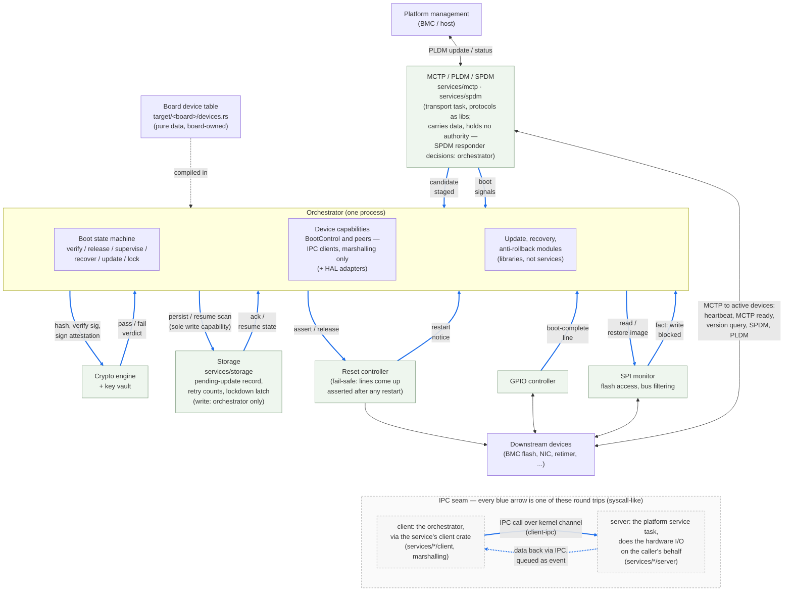
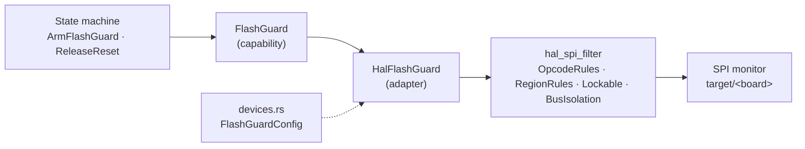
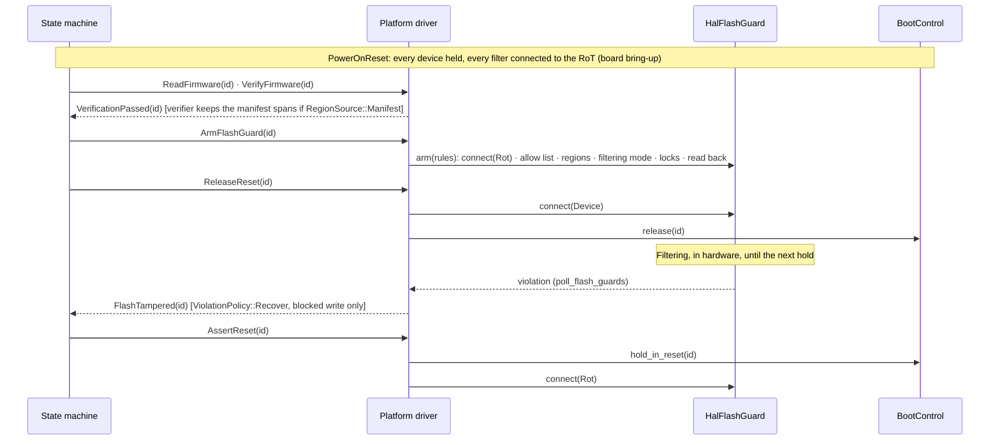

# Platform Architecture

Every decision — when a device leaves reset, which image gets verified,
whether an update activates — is made in the [state
machine](./orchestrator-machine.md); what those decisions are and how
they sequence is that page's subject, not this one's. The platform is
everything around that core: the sensors that feed it events and the
actuators that carry out its effects. This page describes that half —
the layers inside the orchestrator process, the platform services it
calls, the board device table, and the fail-safe rules at the
responsibility boundary.

## Structure

At the core sits the [state machine](./orchestrator-machine.md)
(`services/orchestrator/sm`), a pure reducer that consumes events
(verification results, boot signals, update requests, timeouts) and
emits effects (verify this image, release that reset, restore golden
image), performing no I/O itself. It is the policy half, not part of
the platform. The platform contributes two board-agnostic layers
inside the orchestrator process:

- **Device capabilities** (`services/orchestrator/capabilities`) — the narrow contracts
  the state machine's effects are executed against, e.g. `BootControl`
  (hold a device in reset / release it). HAL bindings live in
  `services/orchestrator/adapters/hal`.
- **Board device table** (`services/orchestrator/config`, schema; values in
  `target/<board>/devices.rs`) — declares the managed devices: reset signal,
  boot checkpoints and windows, commit policy. Validated at compile time, so
  a malformed table is a build error.

## Responsibility Scope

The orchestrator stops at the capability contracts.
Controllers that access signals and buses belong to the platform HAL and
drivers; crypto and transport are services it *uses* but does not own.
Two rules follow:

- **Decide *what*, never *how*.** The orchestrator says "hold device 3
  in reset" — not "drive GPIO pin 14 low." The pin-to-device mapping lives
  in the board device table; the register access lives in the HAL behind
  the capability traits. Porting to a new board means a new table and HAL,
  zero policy changes.
- **Protection survives its crash.** The SPI monitor filters flash traffic
  in hardware, on its own; the orchestrator only loads its rules at
  boot and is not in the data path, and the hardware write filter stays
  armed until the device's first fetch, closing the
  time-of-check/time-of-use window. Busy or crashed, the orchestrator
  cannot be bypassed — there is nothing to bypass.

The six green boxes outside the orchestrator box are platform services — each
one its own task, reached the way a syscall is: the orchestrator issues an IPC
call, the service performs the hardware interaction on its behalf, and the data
comes back via IPC. Each service follows the crate layering established by
[`services/i2c`](https://github.com/OpenPRoT/openprot/tree/main/services/i2c)
and
[`services/mctp`](https://github.com/OpenPRoT/openprot/tree/main/services/mctp):
`api` (wire protocol), `client` (marshalling, host-buildable), `client-ipc`
(the kernel-channel transport), `server` (dispatch onto the hardware). Boxes
name their crates where the service exists today; the rest follow the same
pattern as they land. Five rules govern how the orchestrator relies on them:

- **Facts, not verdicts.** Services report what they observed — the SPI
  monitor a blocked write, the transport a missed heartbeat — never what
  it means. "Corruption" is a verdict, and verdicts are made in one
  place only: the state machine.
- **Never block.** Commands are fire-and-forget; every reply (a crypto
  verdict, a storage ack) returns as a queued event, so a long image hash
  cannot delay the judgment of a boot window elsewhere.
- **Exclusive security state.** Only the orchestrator holds the write
  capability for the lockdown latch, retry counts, and pending-update
  record; a persist with unknown outcome counts as failed and latches the
  machine locked.
- **Fail-safe resets.** Managed reset lines default to asserted in
  hardware on every controller restart, not just cold boot — a
  controller crash resets healthy running devices. That availability
  hit is deliberate: an unsupervised release is never accepted. The
  restart notice makes the orchestrator re-run the boot walk.
- **Transport without authority.** Images and attestation are
  authenticated end-to-end (signatures via crypto, SPDM sessions), so the
  transport can drop traffic but never forge it; a dropped boot signal
  just becomes a checkpoint timeout, and the boot-complete GPIO line
  remains a transport-free liveness path.

## Flash guarding

The "protection survives its crash" rule above is implemented by one
capability, one adapter, two table entries and one effect/event pair. The
HAL contract the adapter drives, and the four chips it was derived from, are
on the [SPI flash filter](../spi-filter.md) page; this section is the
orchestrator's side of it.

- **`FlashGuard`** (`services/orchestrator/capabilities`) is the capability
  the reducer's `ArmFlashGuard` effect executes against: `arm(rules)`,
  `connect(owner)`, `take_violation()`. Like its peers it is bounded only by
  `core::error::Error`, so a mock or an IPC proxy implements it without a
  HAL. `arm` is deliberately coarser than the HAL: "make these rules true",
  not "set this bit", so the reducer and its tests never see opcodes,
  privilege tables or lock registers.
- **`HalFlashGuard`** (`services/orchestrator/adapters/hal`) implements it
  over the `hal_spi_filter` traits from a `GuardWiring` the board declares:
  the opcodes, the chip's filtering mode, the two bus connections, the lock
  targets its lock policy maps to, and how the chip's log record reads as a
  `Violation`. It is the only code that knows a filter has slots, tables and
  lock bits.
- **`FlashGuardConfig`** (`services/orchestrator/config`) is the table
  entry: which filter, which opcodes, where the writable spans come from
  (`RegionSource::Table` or `Manifest`), `FilterLockPolicy`, and
  `ViolationPolicy`. The rationale for each policy's default is on the enum.
  The driver binds one `GuardBinding` per component from it.
- **`Effect::ArmFlashGuard(id)`** is emitted directly before every
  `ReleaseReset(id)`; a component with no guard executes it as a no-op.
  **`Event::FlashTampered(id)`** is a blocked write under
  `ViolationPolicy::Recover` and takes every `CorruptionDetected(id)` arm.

### The boot sequence, with actors

1. **Hold.** Board bring-up leaves every managed device in reset and every
   filter connected to the RoT. The RoT reads and verifies the image through
   the flash HAL on its own controller; the filter is not in that path.
2. **Configure.** On `ArmFlashGuard(id)` the adapter loads the opcode list
   and the writable spans and switches the chip to filtering. The spans come
   from the table, or from the manifest the verifier just authenticated, so
   a new image with a new layout is armed correctly with no special case.
   This runs on every verify, not on every host reset: the rules can only
   legitimately change when the verified image changes.
3. **Lock.** Per `FilterLockPolicy`. `CommandsOnly` locks the allow list and
   the control registers through `Lockable::lock`; `All` freezes the region
   tables too, once, and later arms must present the same rules or fail.
4. **Release.** `connect(Device)`, then `BootControl::release`. The filter
   has been enforcing since step 2, so there is no window between the mux
   switch and the first fetch in which the device sees an unfiltered bus.
5. **Monitor.** The driver drains violations (`poll_flash_guards`) into the
   report sink and applies `ViolationPolicy`. A device that resets at
   runtime is caught by `BootWatch`, enters recovery through `BootFailed`,
   and is re-verified and re-armed on the way back through
   `PreSupervision`.

A failed arm, like any failed effect, becomes `EffectFailed` and latches
`Locked`: a filter that cannot be proven armed does not get a device released
behind it. Arming a device that has no guard succeeds and does nothing, so
one reducer serves boards with and without filters.

### Prior art

The one shipping implementation on the same hardware is ASPEED's PFR
firmware for the AST1060. It arms the filter from the manifest on every host
reset, never sets the lock bits, and only logs violations. This design
departs on all three: it locks the command table (the opcode list is a
property of the flash part), re-arms on verification (the rules follow the
image), and treats a blocked write as evidence (a device overwriting its own
firmware is not trusted to keep running). The register-level account of
ASPEED's sequence, and the questions it leaves for the EVB, are in
`target/ast10x0/peripherals/spimonitor/README.md`.

## TODO

- Define the lockdown latch: where it lives, what "locked" gates, and
  how it is cleared. Latching on a failed persist must not itself depend
  on the storage service that just failed.
